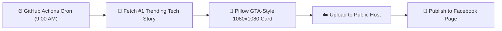

# Tech-Safkat Daily Facebook Briefing 🚀

Automated, cloud-hosted daily tech news poster for **Tech-Safkat** on Facebook. Runs completely serverless on **GitHub Actions** every day at **9:00 AM Asia/Dhaka time** — even when your computer is shut down.

---

## ⚡ How It Works

1. **Trigger:** Fires every day at 03:00 UTC (9:00 AM Asia/Dhaka) or manually via the "Run workflow" button.
2. **News Fetching:** Fetches top trending stories from The Verge, 9to5Mac, and Google News Tech.
3. **Card Generation:** Generates a 1080x1080 square photo card with:
   - Center-cropped high-res official press photo
   - Non-linear cubic bottom gradient fade to `#050508`
   - Watermark: `TECH-SAFKAT • TECH NEWS`
   - Highlight Pill: `🔥 [KEY STAT OR CALLOUT]`
   - Massive Bold Headline & Subtitle
   - Footer: `ARTIFICIAL INTELLIGENCE` & `fb.com/Tech-Safkat`
4. **Publishing:** Automatically posts the image and caption to Facebook Page `Tech-Safkat`.

---

## 🔑 Configuration (GitHub Secrets)

Navigate to **Settings > Secrets and variables > Actions > New repository secret** in your GitHub repo and add the following:

### 1. Facebook Publishing (Choose ONE method)

#### Method A: Zapier Webhook (Recommended & Easiest)
Since you already have Facebook Pages connected in Zapier:
1. Go to [Zapier](https://zapier.com/app/zaps) and click **Create Zap**.
2. **Trigger:** Choose **Webhooks by Zapier** -> Event: **Catch Hook**.
3. Copy your unique **Webhook URL**.
4. **Action:** Choose **Facebook Pages** -> Event: **Create Page Photo**.
   - Page: `Tech-Safkat` (`1228167307048422`)
   - Photo: Select `Image Url` from the webhook
   - Description: Select `Message` from the webhook
5. Save and turn ON your Zap.
6. In GitHub, add secret:
   - `ZAPIER_WEBHOOK_URL` = `<your_copied_zapier_webhook_url>`

#### Method B: Direct Facebook Graph API Token
If you prefer direct Facebook Graph API without Zapier:
- `FB_PAGE_ACCESS_TOKEN` = `<your_permanent_page_access_token>`
- `FB_PAGE_ID` = `1228167307048422` (defaulted in code)

---

### 2. Optional: Gemini AI Summarizer (Free)
To have Gemini AI automatically analyze the story and craft the headline, hook, and takeaways:
- `GEMINI_API_KEY` = `<your_google_ai_studio_api_key>` (from [aistudio.google.com](https://aistudio.google.com))
*(If omitted, a smart rule-based formatter will format the post automatically)*

---

## 🧪 Manual Testing

1. Go to the **Actions** tab in this GitHub repository.
2. Click **Daily Tech-Safkat Facebook Briefing** on the left.
3. Click **Run workflow** -> **Run workflow**.
4. Check the logs and download the generated photocard from the **Artifacts** section at the bottom of the run!
